<div align="center">

# 🚀 Ask2App
### *Make All Software Free. Ask. Answer. App Delivered.*

**Generate complete, production-grade, deployable applications from structured decisions — delivered with 100% full source code you own.**

[](https://ask2app.com)
[](https://dotnet.microsoft.com/)
[](https://ask2app.com)
[](https://ask2app.com)
[](https://ask2app.com)
[](https://azure.microsoft.com/)

<p align="center">
  <a href="https://ask2app.com"><b>🌐 Live Generator</b></a> •
  <a href="#-how-it-works"><b>⚡ How It Works</b></a> •
  <a href="#-supported-technology-stacks"><b>🧱 Supported Stacks</b></a> •
  <a href="#-flagship-reference-applications"><b>🌟 Flagship Applications</b></a> •
  <a href="#-enterprise--commercial-services"><b>🏢 Enterprise Services</b></a> •
  <a href="#-contact--consulting"><b>📫 Contact</b></a>
</p>

---

</div>

## 💡 What is Ask2App?

**Ask2App** is a next-generation, decision-based AI software synthesis platform hosted at [ask2app.com](https://ask2app.com).

Traditional low-code tools trap your business in closed ecosystems, monthly runtime subscription fees, and proprietary black boxes. **Ask2App eliminates vendor lock-in entirely.** 

Instead of forcing you into cumbersome drag-and-drop builders or fragile prompt engineering, Ask2App guides you through high-level architectural and business decisions — or reads your database schema via CSV or visual design — and delivers a complete, cleanly structured, compilable software solution directly to you as a ZIP file.

> [!IMPORTANT]
> **Zero Vendor Lock-in & 100% Source Code Ownership**  
> The generator is free to use, and **all source code it produces is 100% customer-owned**. You get clean C#, TypeScript, Python, or Delphi code with standard project structures, Docker containers, automated database migrations, and CI/CD pipelines.

---

## ⚡ How It Works

```
┌────────────────────────┐      ┌────────────────────────┐      ┌────────────────────────┐
│        1. WE ASK       │      │      2. YOU ANSWER     │      │    3. APP DELIVERED    │
│  Guided Questions      │ ───► │  Architectural Choices │ ───► │  Complete Solution ZIP │
│  & Schema Modeling     │      │  & Feature Toggles     │      │  + 100% Source Code    │
└────────────────────────┘      └────────────────────────┘      └────────────────────────┘
```

1. **We Ask**: Structured, intuitive questions walk you through your business requirements, entities, workflows, and integrations. Prefer to draw it? Use our visual [Schema Designer](https://abpgenerator.ask2app.com) or upload a plain CSV.
2. **You Answer**: Select your client frontend (Blazor, React, MAUI, Expo, WinForms, Delphi), database provider (PostgreSQL, SQLite, SQL Server), security posture, and cloud target.
3. **App Delivered**: In minutes, Ask2App delivers a complete, verified application solution archive with automated database migrators, seed data, responsive UI, OpenAPI documentation, and local/cloud deployment scripts.

---

## 🧱 Supported Technology Stacks

Ask2App delivers architectural parity across **10+ major client stacks** and enterprise backend runtimes:

| Tier | Supported Technologies & Frameworks | Highlights |
| :--- | :--- | :--- |
| **Modern Web** | **Blazor WebAssembly** (MudBlazor, Radzen, Tailwind), **React** (Tailwind CSS, Fluent UI), **Next.js** | Single-page apps, reactive state management, Dark/Light theme toggle, instant hot reload. |
| **Mobile & Tablet** | **.NET MAUI** (iOS, Android, macOS), **React Native / Expo** (NativeWind, Paper, Gluestack, shadcn) | Native performance, in-app checkout transitions, camera/push-notification hardware access. |
| **Enterprise Desktop** | **WinForms (.NET 10)**, **Delphi VCL**, **Delphi FireMonkey**, **Delphi + Skia**, **Godot** | **Zero third-party dependencies** in WinForms & Delphi VCL. Full parity with web admin portals. |
| **Server & Cloud APIs** | **ASP.NET Core Minimal APIs**, **.NET Aspire**, **ABP Framework**, **YARP Microservices Gateway** | Dependency injection, distributed cache, OpenTelemetry spans, Polly resilience pipelines. |
| **Data & Storage** | **Entity Framework Core 10**, **PostgreSQL Flexible Server**, **SQLite**, **SQL Server** | Automated migration runners, multi-tenancy query filters, soft deletes, connection pooling. |
| **Autonomous AI** | **Semantic Kernel**, **OpenAI**, **Azure OpenAI**, **Anthropic**, **Local Ollama / LM Studio** | Vector RAG pipelines, cosine similarity search, chunk citations, multi-model resilient failover. |

---

## 🛠️ Enterprise Architecture Built-In

Every application synthesized by Ask2App comes equipped with enterprise infrastructure out of the box:

```mermaid
flowchart LR
    subgraph Client["🖥️ Multi-Stack Client Layer"]
        B["Blazor WASM\n(MudBlazor)"]
        R["React / Next.js\n(Tailwind)"]
        M[".NET MAUI / Expo\n(iOS & Android)"]
        D["WinForms / Delphi\n(Desktop Parity)"]
    end

    subgraph Gateway["🛡️ Gateway & Identity Layer"]
        YARP["Reverse Proxy & Gateway"]
        AUTH["JWT / ASP.NET Identity\nRBAC & 2FA"]
    end

    subgraph Core["⚙️ Enterprise Application Core"]
        API["ASP.NET Core / .NET Aspire\nMinimal APIs & Scalar Docs"]
        RAG["Vector RAG & AI Agents\nSemantic Kernel & Ollama"]
        TENANT["SaaS Multi-Tenancy\nTenant Isolation & Branding"]
        JOBS["Background Worker Queue\nAudit Logging Interceptors"]
    end

    subgraph Data["💾 Distributed Data & Storage"]
        DB[(PostgreSQL / SQLite / SQL Server)]
        VEC[(Vector Embeddings)]
        BLOB[(Azure Files / S3 Storage)]
    end

    Client --> YARP
    YARP --> AUTH
    AUTH --> Core
    Core --> Data
```



### Key Capabilities in Every Solution:
* 🔐 **Authentication & Security**: ASP.NET Core Identity, JWT Bearer tokens, hierarchical Role-Based Access Control (RBAC), fine-grained permission trees, and optional 2FA.
* 🏢 **SaaS Multi-Tenancy**: Dynamic tenant resolution by sub-domain or header, tenant-isolated data via EF Core query filters, customizable per-tenant branding and theme palettes.
* 🤖 **AI Knowledge Base & Vector RAG**: Chunking and tokenization pipelines, cosine similarity retrieval, grounded citations, and autonomous tool-calling execution agents.
* 📊 **Deep Observability**: Native OpenTelemetry distributed tracing, Prometheus metrics endpoints, waterfall transaction spans, and real-time HTTP audit loggers.
* 💳 **Payment & Commerce**: Stripe Checkout integration, signed idempotent webhooks, cart engines, and in-app mobile checkout return loops.
* 📜 **Modern Developer Experience**: Scalar interactive OpenAPI documentation with Mars theme, automated test suites, and Docker Compose orchestration.

---

## 🌟 Flagship Reference Applications

Ask2App maintains over **20+ production-grade reference solutions** showcasing real-world performance:

| Application | Architecture & Stack | Description & Live Links |
| :--- | :--- | :--- |
| **[NovaMesh](https://github.com/donpotts/NovaMesh)** | `.NET 10` • `Aspire` • `Blazor WASM` • `Scalar` | Distributed cloud microservices mesh with OpenTelemetry waterfall tracing, Polly resilience policies, and CMS Blog Hub. |
| **MyExecutiveSuite** | `SaaS ERP` • `CRM` • `HRM` • `EDI X12` | Enterprise resource suite with a visual workflow engine, AI digital employees, fleet management, and Excel Add-in.  <br>🌐 [suite.ask2app.com](https://suite.ask2app.com) • 🎮 [demo.ask2app.com](https://demo.ask2app.com) |
| **AbpGenerator & Designer** | `ABP Framework` • `MudBlazor` • `.NET MAUI` | Turn plain CSVs or visual schema diagrams into full ABP solutions with Stripe, chat, and 27-theme switchers. <br>🌐 [abpgenerator.ask2app.com](https://abpgenerator.ask2app.com) |
| **LeadFinder** | `Multi-Tenant CRM` • `Playwright` • `Google Places` | Automated multi-tenant B2B lead generation CRM with real-time scraping fallbacks and pipeline tracking. |
| **My AI Orchestrator** | `Semantic Kernel` • `Multi-LLM` • `Local AI` | Intelligent agent chat router that dynamically fails over between OpenAI, Azure OpenAI, Anthropic, and local Ollama nodes. |
| **BlazerSuite & MyEntApps** | `Enterprise Monolith` • `8 Integrated Portals` | Single-UI multi-app suite managing Helpdesk, Invoicing, Rosters, Assets, Bookings, Projects, and Clinic scheduling. |

---

## 🛡️ The "Verified Before Delivery" Quality Guarantee

A common flaw with AI coding assistants is generating code that superficially compiles but crashes at runtime.

At **Ask2App**, our automated quality pipeline does not stop at compilation:
1. **End-to-End Execution**: Every template is launched in automated containerized sandbox environments.
2. **Database & Schema Verification**: Automated migrators spin up databases, run schema creation, and execute seeders.
3. **Full CRUD & Auth Walkthrough**: Headless test harnesses authenticate, create entities, edit records, test search filters, and verify reactive UI bindings before code is packaged.

---

## 🏢 Enterprise & Commercial Services

Ask2App's business model is transparent: **the generator and the generated code are free**. 

We generate revenue by delivering high-value engineering and infrastructure services to startups, enterprises, and modernization teams:

```
┌─────────────────────────────────────────────────────────────────────────────┐
│                           COMMERCIAL SERVICES                               │
├──────────────────────┬──────────────────────┬───────────────────────────────┤
│ 🛠️ Custom Engineering│ ☁️ Managed Hosting    │ 🔄 Legacy Modernization       │
│ Bespoke integrations,│ Turnkey Azure ACA    │ Upgrade legacy WinForms,      │
│ specialized workflows│ deployment, scaling, │ Delphi, Web Forms, or ASP.NET │
│ and proprietary APIs.│ monitoring & backups.│ to modern .NET 10 & Blazor.   │
├──────────────────────┼──────────────────────┼───────────────────────────────┤
│ 🛡️ 24/7 Enterprise   │ 🎓 Developer Training│ 📐 Architecture Audits        │
│ Dedicated SLA, bug   │ Upskilling teams on  │ Performance profiling, security│
│ fixes, patch updates.│ ABP, Blazor & Aspire.│ reviews & cloud cost trimming.│
└──────────────────────┴──────────────────────┴───────────────────────────────┘
```

---

## 🌐 Live Azure Ecosystem

Ask2App is Microsoft-stack-native and battle-tested on Azure:
* 🚀 **Generator Portal**: [ask2app.com](https://ask2app.com)
* 🏢 **Executive Suite**: [suite.ask2app.com](https://suite.ask2app.com)
* 🧪 **Public Sandbox**: [demo.ask2app.com](https://demo.ask2app.com)
* 📐 **Visual Schema Designer**: [abpgenerator.ask2app.com](https://abpgenerator.ask2app.com)

---

## 📫 Contact & Consulting

Have an enterprise app to build, a legacy system to migrate, or need tailored consulting?

* 🌐 **Web**: [ask2app.com](https://ask2app.com)
* 📧 **Founder & Principal Architect**: **Don Potts** — [Don.Potts@Ask2App.com](mailto:Don.Potts@Ask2App.com)
* 🐙 **GitHub Organization**: [github.com/Ask2App](https://github.com/Ask2App)

<div align="center">

---

**We ask. You answer. App delivered.**  
*Accelerating Global Software Creation with 100% Free, Customer-Owned Code.*

</div>
